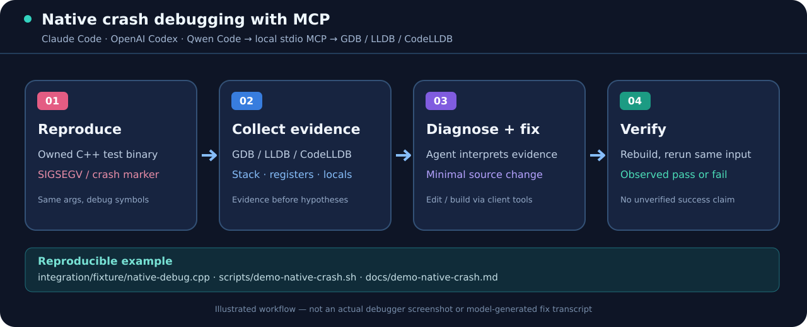

# Reproducible C++ crash → evidence → verification demo

**Audience:** developers using Claude Code, OpenAI Codex CLI, Qwen Code or another *local stdio MCP* client for native debugging. This demo runs only [the repository-owned C++ fixture](https://github.com/spk-c/Qwen-dap-mcp/blob/main/integration/fixture/native-debug.cpp) and leaves your own applications untouched.



*The diagram is an illustration, not an actual AI session recording. The shell demo below runs GDB directly; it is deliberately not presented as evidence that an AI agent automatically fixed a crash.*

## 1. Reproduce a real native fault and verify a small change

On **Linux**, install a C++ compiler and **GDB** (with permission to debug the test process). From a trusted checkout:

```bash
git clone https://github.com/spk-c/Qwen-dap-mcp.git
cd Qwen-dap-mcp
bash scripts/demo-native-crash.sh
```

The script:

1. Builds `integration/fixture/native-debug.cpp` with debug symbols, runs the normal path, and checks `NATIVE_FIXTURE_OK`.
2. Invokes local **GDB** on a new instance of that fixture using the `crash` argument. The program deliberately dereferences a null pointer; the script *requires* actual `SIGSEGV` and the `crash_marker` function in the collected backtrace. It fails otherwise.
3. Copies the source into an automatically cleaned temporary directory and applies a **demonstration-only** null guard there. The repository's source file is not changed.
4. Rebuilds the modified fixture, reruns the *same* `crash` argument and checks for normal completion.

Typical milestones (labels are expected; detailed debugger stack frames and addresses vary with compiler/OS):

```text
STEP 1 — Compile and run a repository-owned C++ fixture
NATIVE_FIXTURE_OK
STEP 2 — Reproduce the deliberate crash under a local GDB process
... SIGSEGV ...
... crash_marker ...
STEP 3 — Apply an illustrative null-pointer guard ONLY to a temp copy
STEP 4 — Rerun EXACTLY the crash argument against the modified build
NATIVE_FIXTURE_OK
PASS: observed deliberate SIGSEGV, crash_marker stack and successful rebuilt reproduction.
```

This simple guard proves the demonstration path, **not** that null checks solve every real-world crash. No customer process or production application is attached.

## 2. Connect your actual AI coding agent via MCP

Install Node.js 20+ and a supported DAP adapter (GDB's DAP interpreter, `lldb-dap` or CodeLLDB). Choose your local client:

```bash
# Claude Code — local CLI
claude mcp add --transport stdio --scope user qwen-dap-mcp -- npx -y @slp-dev1/qwen-dap-mcp

# Or Codex CLI — local CLI
codex mcp add qwen-dap-mcp -- npx -y @slp-dev1/qwen-dap-mcp
```

Then verify the registered server and tools: `claude mcp list`, `codex mcp list`, and the client's interactive MCP tool list. A registration alone does not prove GDB/LLDB or a real native debug session works.

From a built source checkout, you can also run `npm ci && npm run build && npm run test:clients` to exercise the **real stdio MCP initialize/tools-list handshake**. That test uses simulated client identities and doesn't claim a model-driven diagnosis.

## 3. Ask the agent to inspect the same owned fixture

Example prompt:

> Debug my authorized test binary built from `integration/fixture/native-debug.cpp` with the argument `crash`. First check whether a compatible local DAP adapter is available. Use Qwen DAP MCP and `debug_this_crash` to collect the signal/exception, `crash_marker` stack frame, registers and relevant locals. Separate observations from hypotheses. If proposing a code change, work in a disposable copy, rebuild with debug symbols and repeat the exact argument before saying it is fixed.

This *request* documents the intended workflow; the shell demonstration above does **not** invoke `debug_this_crash` or claim an authenticated Claude/Codex session was executed. The agent's normal authorized file/build tools, not the MCP debugger server, apply changes.

For a full native adapter run, see the maintained [native debugger E2E tests](https://github.com/spk-c/Qwen-dap-mcp/blob/main/integration/README.md) and the [GDB DAP guide](https://github.com/spk-c/Qwen-dap-mcp/blob/main/docs/gdb-dap.md). On Windows, follow the [CodeLLDB minidump tutorial](https://github.com/spk-c/Qwen-dap-mcp/blob/main/docs/tutorial-windows-minidump.md).

## Safety and boundaries

- Local stdio MCP is **not** a publicly accessible remote HTTP endpoint. A cloud-hosted chat cannot automatically debug your desktop processes.
- Keep `QWEN_DAP_MCP_PROFILE=inspect` for postmortem-only analysis; live launch/attach needs explicit authorization and a suitable policy.
- Do not expose raw debugger ports on public networks.
- If a debugger/adapter is unavailable, report the failure rather than fabricating a backtrace.

## Official distribution links

- [npm: @slp-dev1/qwen-dap-mcp](https://www.npmjs.com/package/@slp-dev1/qwen-dap-mcp)
- [Official MCP Registry listing](https://registry.modelcontextprotocol.io/v0.1/servers?search=io.github.spk-c%2Fqwen-dap-mcp)
- [Source, releases and checksums](https://github.com/spk-c/Qwen-dap-mcp/releases)
